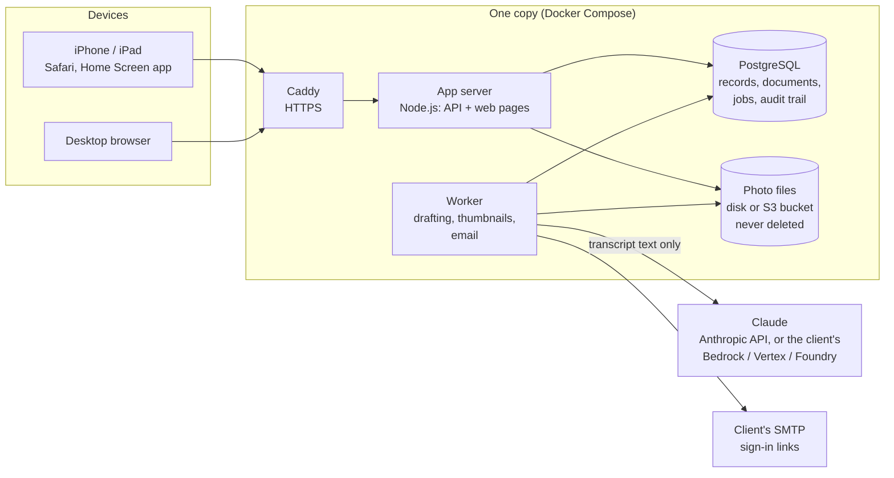
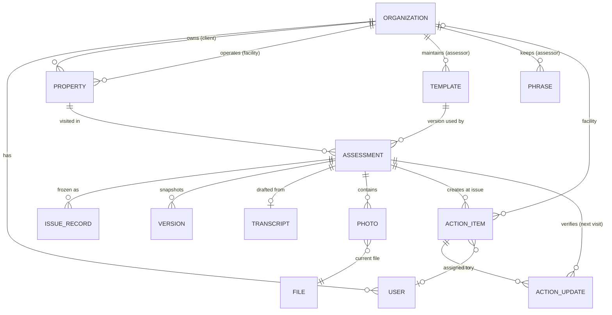

# v2 Build Plan

Nov 25, 2026 · Milestone 1 (Plan). For review before any app code is written. It is based on `docs/spec.md` (Nov 25), `CLAUDE.md`, the Nov 23 and Nov 24 meeting notes, and v1 (`mgmegg-commits/cecil-report-app`, `main` at `03104a2`, Nov 25).

> **Nov 26, 2026: simplified.** Cecil has a beta test with a skilled nursing operator that owns 45 sites, so v2 is now the simplest version that works end to end: v1's approved screens and workflow, plus follow-up on action items. **Section 10 onward describes what's being built now.** Sections 1 to 9 describe the full design, which stays the long-term direction for when a paying customer needs it. Where they differ, section 10 onward wins. The Nov 25 plan for sections 10 to 12 is kept, collapsed, at the end.

---

## 1. Summary

**What gets built.** One app that covers the whole cycle. Cecil uploads his voice memo and photos and gets a drafted report. He edits it on the screens he already approved in v1 and issues it. Issuing freezes the report as observed and turns its action items into a live tracker. The client's asset team assigns each item to a facility and sets a due date. Facility staff update items from a phone with a note and a photo. At the next visit Cecil marks each item fixed, not fixed or worse.

**How it's built.** It's one program that keeps each organization's data separate (Cecil's firm, each client, each facility). It ships as one installable package (Docker). That same package can run as Cecil's own copy on a small cloud server, or on a client's own server for clients who want that. A client who doesn't need their own server can have its own walled-off organization in Cecil's copy instead. So the "one copy per client" assumption stays possible without being something we have to bet on now. Drafting calls Claude from the server. In a client's copy it uses that client's own Claude account (or their Amazon, Google or Microsoft cloud account). Claude doesn't train on that data.

**Order of work.**
1. **Assessor workflow (Milestone 2).** Everything Cecil does in v1, rebuilt on a real database with accounts. Test: rebuild the Midlands report and draft a real walk-through.
2. **Follow-up (Milestone 3).** Tracker, assignment, phone updates, overdue flags, exports, and the check at the next visit. Test: one full cycle with three people on phones.
3. **Second client copy (Milestone 4).** Install guide, backups, updates, branding, license key. Test: two copies share nothing.
4. **Field use (Milestone 5).** The February South Carolina hospital reports go out from v2. v1 stays available as the fallback.

**Decisions.** Michael approved the plan on Nov 25 with the answers recorded in `docs/decisions.md` and the spec's Decisions log. Four are provisional: 2 (to confirm with Cecil's IT contact before Milestone 4), 5 and 8 (to confirm with Cecil) and 11 (to a lawyer later). 12.20 (whose Claude account drafting uses) was answered the same day: the recommendation was accepted.

---

## 2. Hosting and architecture

### What every option shares

v2 is one web application: a server, a PostgreSQL database, and a folder (or bucket) of photo files. Phones, iPads and desktops use it through the browser. Cecil adds it to his Home Screen as he does with v1. The app is multi-organization in every option. Even a single client's copy holds at least three organizations: Cecil's firm, the client, and each facility operator. The only question is how many copies we run and where.

### Option A: one copy per client, on the client's server (the working assumption)

Each client's IT installs the package on their own Linux server or cloud account. Cecil runs his own copy for his firm.

| | |
| --- | --- |
| **Installing** | Client IT gets a Docker Compose file, an `.env` template and an install guide. They need a Linux server (or VM) with Docker, a DNS name, a TLS certificate (or let the bundled Caddy get one), an SMTP server for sign-in emails, and somewhere to keep photos (local disk or an S3-compatible bucket). About half a day for an IT person, plus security review. |
| **Updating** | We publish a versioned image. Client IT runs `./update.sh` (back up, pull, migrate, restart) whenever they choose. Every copy is updated separately, so different clients can run different versions for a while. |
| **Backups** | The client's responsibility. We supply a nightly backup script (database dump plus photo files, encrypted) and a restore test. |
| **Cost** | The client pays for their server (roughly $40 to $150 a month for a small VM, plus storage). Our cost is support time per copy: each install, each update, each "it's not working". |
| **Good** | The data never leaves the client's control, and the copy can carry the client's branding. It matches what Cecil believes owners want, and it suits a yearly license. |
| **Hard** | N copies to support. Every client IT department is different, and some are Windows-only. Cecil has to have an account in every client's copy to do their assessments. His drafting examples and phrases live in each copy separately. |

### Option B: one hosted site for everyone

We run one site (for example `reports.cecilingram.com`). Each client is an organization in it, with its own branding.

| | |
| --- | --- |
| **Installing** | Nothing for clients. Adding a client is an admin task that takes about ten minutes. |
| **Updating** | Once, for everyone. |
| **Backups** | Ours: managed database backups plus object-storage versioning, done once. |
| **Cost** | One cloud server plus a managed database plus storage: roughly $60 to $200 a month in total. The cost grows mainly with photos (about 1 to 2 GB per assessment if originals are kept). |
| **Good** | Least work by far. Cecil sees all his clients in one place, and the program coordinator view (F-10) across firms is natural. |
| **Hard** | Clients' data sits on a server we run, which large owners may refuse. Data separation rests entirely on the app being correct, so it needs the strictest testing. It contradicts the spec's working assumption. |

### Option C: build once, install anywhere (recommended)

The same multi-organization package as B, shipped the way A needs. Cecil's copy runs on a small cloud server that we manage, and clients without their own server get an organization in it. A client who wants their own copy gets the same package installed on their server, with nothing shared with Cecil's copy.

| | |
| --- | --- |
| **Installing** | Cecil's copy: we set it up once. A client copy: as in A. |
| **Updating** | One image, one `update.sh`. Cecil's copy is updated first, and client copies follow when their IT is ready. |
| **Backups** | Cecil's copy: ours, automated. Client copies: theirs, with our script. |
| **Cost** | Cecil's copy: about $30 to $80 a month (VM, storage, backups). Client copies: the client's server, plus our support time per copy. |
| **Good** | Nothing is decided too early. If Cecil's IT contact says owners don't actually need their own servers, we just stop offering it. Milestone 4's test ("nothing shared between two copies") still applies. |
| **Hard** | Data separation has to be right in both modes: between organizations inside a copy, and between copies. That's two kinds of testing, both planned below. |

**Recommendation: Option C** (approved Nov 25). It costs almost nothing extra over A, because the app needs organizations and roles anyway, and it keeps B available. Confirm with Cecil's IT contact before Milestone 4. The plan only depends on that answer from Milestone 4 on.

**Where Cecil's copy runs is not chosen yet** (12.17). Until he uses v2 for real there's no staging server: the package runs on Michael's Mac with Docker Desktop. It stays portable between a Mac, Cecil's computer, a managed host and a small cloud server, so the same Compose file and images work everywhere, with nothing tied to one provider.

### Shape of one copy

The app server and the worker are the same image started two ways, so a client copy is four containers: Caddy, app, worker and Postgres. A copy can use the client's own managed Postgres and bucket instead of the bundled ones.

**Security in every option.** HTTPS only (HSTS). Data at rest sits on encrypted volumes: the client's disk encryption, or encrypted EBS / Azure disks and buckets in cloud copies. Backups are encrypted. Photos are served only through the app after a permission check, never from public bucket URLs. There are no public links: every link belongs to one signed-in person (section 5). Each copy holds its own secrets (database password, session key, AI key) in environment variables, never in the repo.

**Licensing.** A yearly license key is a small signed file naming the copy, the licensee and the expiry date. The copy checks it offline, so no call goes home, which IT departments prefer. When it lapses the copy becomes read-only after a 30-day grace period: reports, items, PDFs and exports stay readable, while new assessments, drafting and edits stop. Data is never locked away.

---

## 3. Tech stack

All of these are open source, widely used and actively maintained. Client IT departments will recognize every one.

| Part | Choice | Why |
| --- | --- | --- |
| Language | TypeScript (strict) | One language on server and browser. v1's JavaScript ports over with type checks added. |
| Runtime | Node.js 22 LTS | v1 already runs on it. It's a long-term-support release with security fixes into 2027. |
| Server framework | Fastify 5 | Well maintained, and it validates every request against a schema. |
| Database | PostgreSQL 16 | Free and familiar to IT. It handles JSON documents (JSONB) and row-level security for keeping organizations apart. |
| Database access and migrations | Drizzle ORM and drizzle-kit | Typed queries, and migrations are plain numbered SQL files that a reviewer can read. |
| Background jobs | pg-boss | A job queue inside Postgres (drafting, thumbnails, email), so there's no extra service to install. |
| Validation | Zod | v1 already uses it. The same schemas check API requests, stored documents and Claude's answers. |
| Web pages | React 19 with Vite | The most common UI library, so any developer can maintain it. Good touch and drag support on iPad. |
| Server data in the page | TanStack Query | Caching and automatic retries, which matter on a weak signal. |
| Drag and drop | dnd-kit | Works with touch on iPad (the All Photos tray, reordering). |
| Styling | v1's `styles.css`, split per screen (CSS modules) | Keeps the look Cecil approved, with no new CSS framework. |
| Photo processing | sharp (libvips) on the server; exifr and heic2any on the device | Fast thumbnails on the server. HEIC and EXIF handling as in v1 (section 7). |
| PDF | jsPDF and jspdf-autotable, as in v1 | The layout Cecil approved, ported rather than redrawn. |
| Excel | xlsx-js-style, as in v1 | Writes the tracker with a bold header and wrapped text. Bundled with the app, not loaded from a CDN. |
| Claude | `@anthropic-ai/sdk`, plus its Bedrock, Vertex and Foundry clients | The official SDKs, and the same code v1 uses. The provider is chosen per copy. |
| Sign-in | Own small module for links and sessions; `@simplewebauthn` for Face ID / Touch ID; `openid-client` for company single sign-on | Standard, audited libraries for the hard parts (section 5). |
| Email | Nodemailer over SMTP | Works with any mail server, including the client's own. |
| File storage | Local disk, or any S3-compatible bucket (`@aws-sdk/client-s3`) | Covers a client's server disk, AWS, and most private clouds. Azure Blob can be added if a client needs it. |
| HTTPS | Caddy 2 | Gets and renews certificates automatically. A client can use their own proxy instead. |
| Packaging | Docker images and Docker Compose | The most widely accepted way to hand software to an IT department. |
| Logs | pino (JSON to standard output) | Fits whatever log tools the client already has. |
| Tests | Vitest (unit and integration against a real Postgres); Playwright in Chromium and WebKit (Safari's engine), at iPhone, iPad and desktop sizes | Real-browser tests on the engine Cecil's devices use. |
| CI | GitHub Actions; images published to GitHub Container Registry (private) | Runs on every PR. |

**Code layout.** This is one repo with three npm workspaces:
- `packages/core`: pure functions with no database and no web page. It holds the assessment document, its migrations, templates, sections, priorities, checks, phrases, versions, the drafting prompt and reading Claude's answer, photo placement, markup geometry, the PDF and the tracker. The server and the browser both use it, as v1's `src/js/model` is used today.
- `apps/server`: the API, sign-in, permissions, storage, jobs and drafting.
- `apps/web`: the screens.

---

## 4. Data model

### Approach

Some data is a document Cecil edits as a whole: the sections, subsections, ratings, findings, and the photos' placement and markup. That keeps one JSON document per assessment, as in v1, stored in a Postgres JSONB column. This keeps v1's tested model functions working nearly unchanged, makes version snapshots and restores trivial, and makes "freeze at issue" a single copy.

Everything that has its own permissions, is shared across visits, or keeps changing after issue becomes a real table: organizations, users, properties, templates, photo files, action items and their updates, transcripts, versions and phrases. Those are what the tracker queries, and what row-level security protects.

Every table row has `id` (random, URL-safe), `created_at`, and `created_by` where a person made it. Every table that holds client data also has `org_id`, the organization the row belongs to, which row-level security uses (section 5). Times are stored in UTC and shown in US format.

### Records from the spec's Data model table

**Organization**: the boundary for keeping data separate.

| Field | Notes |
| --- | --- |
| `name` | "Cecil Ingram Properties LLC", "MPT", "Midlands Regional Hospital" |
| `type` | `assessor_firm`, `client`, `facility_operator` |
| `client_org_id` | For a facility operator: the client whose properties it operates. Scopes it inside a copy. |
| `branding` | Logo file, colors, report name, disclaimer text, PDF footer. As v1's Branding & settings, now per organization. |
| `settings` | Defaults: priority scheme, action order, how "not discussed" prints, standard section lists per template |

**User**

| Field | Notes |
| --- | --- |
| `org_id` | One organization per user. Someone in two organizations gets two users. That's simpler to reason about, and the case is rare. |
| `name`, `email`, `phone` | Email is unique within a copy. The phone number is optional, for texting a sign-in link. |
| `role` | `assessor`, `client`, `facility`, `coordinator`, plus an `is_admin` flag (section 5) |
| `status` | `invited`, `active`, `disabled`. Users are disabled, never deleted, because the audit trail points to them. |
| `last_seen_at` | |

**Property**: the anchor across years.

| Field | Notes |
| --- | --- |
| `client_org_id` | The owner organization. Decides who can see it. |
| `operator_org_id` | The facility organization at the property (optional). Its users see this property's items. |
| `name`, `owner_name`, `use_type`, `operator_name`, `facility_contact` | The names as printed. `operator_name` stays text even when an operator organization is linked. |
| `address`, `lat`, `lng` | `lat` and `lng` are averaged from photo GPS, or entered |
| `parcels` | `[{ pid, address, desc }]` as in v1 |
| `last_assessment_id` | So a new visit carries details, personnel, parcels and Cecil's own subsections over (A-2) |

Changes to a property are recorded in the audit trail, which gives the "property master data with change history" from the Nov 23 notes at no extra cost.

**Template**: one row per template version. A version is never changed once a report uses it.

| Field | Notes |
| --- | --- |
| `assessor_org_id` | Templates belong to the assessor firm (see decision 12.11) |
| `key`, `name`, `version` | `healthcare` / "Healthcare Master" / 2, and `realestate` / "Real Estate" / 2, seeded from v1 |
| `sections` | `[{ key, title, compliance, items: [{ key, label }] }]`. Keys never change. |
| `sentences` | The standard sentences per rating, for subsections and sections (now data rather than code) |
| `priority_schemes` | `hml`, `rr` and their conversions. Data, so a third scheme is a row, not a code change (decision 12.9). |
| `schema` | Version of this JSON shape |

**Assessment**: the row plus the document.

| Field | Notes |
| --- | --- |
| `property_id`, `client_org_id`, `assessor_org_id` | Who it's about, whose it is, and who prepared it |
| `template_id` | The template version it started from |
| `status` | `draft` or `issued` |
| `revision` | 0, 1, 2… as in v1 |
| `follow_up` | `pdf_only` or `tenant_access`, chosen by the client per assessment (F-9) |
| `previous_assessment_id` | Last visit to this property, for A-2 and A-17 |
| `doc` | The JSON document, described next |
| `doc_schema` | Its shape version: v1's sequence continues, so v2 starts at 7 |
| `row_version` | Increases on every save. A save sent with an older number is refused with "This report was changed on another device", so iPad and desktop can't overwrite each other. |

The document (`doc`) keeps v1's shape. It holds the details (date, time, prepared by, personnel, weather, general comments, cover photo), `priorityScheme`, `actionOrder`, the sections with their subsections and findings, and the photos' arrangement. Property facts such as address and parcels are copied into it at the start of the visit. A report then prints what was true on the day, even if the property record changes later.

**Section and subsection**: inside the document, as v1.

| Field | Notes |
| --- | --- |
| `key` | Never changes, so a rename or move never breaks a photo link |
| `title` / `label`, order | Can be added, renamed, moved or deleted per report |
| `rating` | `G`, `F`, `P`, `NA`; a section may be `auto` (worked out from its subsections, decision 12.8) |
| `noMaterialIssues`, `notes` / `summary` | The comment boxes |
| `drafted`, `suggested`, `custom` | Values Claude filled in that Cecil hasn't accepted; a subsection Claude added; one Cecil added |
| `compliance`, `confirmed` | The Regulatory Compliance section (unscored) |

**Finding**: inside the document, under its subsection.

| Field | Notes |
| --- | --- |
| `id` | Stable. It becomes the action item's `finding_id`, which is how items follow a finding across revisions. |
| `description`, `location` | One issue = one finding (A-6). `location` lists every place it was seen. |
| `observationOnly` | No action item |
| `action` | `{ title, recommendation, priority }`. v1's `assignee` and `due` move to the action item, because the assessor never sets them (A-12). v1-shaped test data carries them into the imported item. |
| `drafted`, `sources` | Drafted marks, and the transcript remarks it came from |

**Photo**: a table row for permissions and for keeping things forever, plus its arrangement inside the document.

| Where | Fields |
| --- | --- |
| `photo` table | `assessment_id`, `file_id` (current file), `original_file_id`, `taken_at`, `lat`, `lng`, `width`, `height`, `name`, `signature` (skips duplicates), `hidden_at` (deleted by Cecil: hidden, file kept) |
| `file` table | Immutable: `sha256`, `content_type`, `bytes`, `width`, `height`, `storage_key`, `kind` (`original`, `report`, `thumb`, `rotated`, `logo`, `pdf`, `update_photo`) and the file it was derived from. There is no delete operation at all. |
| In the document (`doc.photos[]`) | `id`, `caption`, `status` (`report`, `appendix`, `excluded`), `item`, `findings`, `alsoIn` (one photo in two places), `overview`, `order`, `markup` (arrows, circles, numbered areas linked to close-ups, text, in red, yellow or white, stored as shapes in fractions of the photo) |

Rotating stores a new rotated file as the photo's `file_id` and keeps the old one, as v1 does. Older versions point to whichever file was current then, so they still show correctly.

**Action item**: created when an assessment is issued. It outlives the assessment.

| Field | Notes |
| --- | --- |
| `assessment_id`, `finding_id`, `property_id`, `client_org_id` | Where it came from and whose it is |
| From the finding (frozen copy): `number` (A1…), `title`, `recommendation`, `priority`, `priority_scheme`, `description`, `location`, `section_label`, `subsection_label`, `photo_ids` | What the report said. It never changes when the item is updated. |
| Live: `facility_org_id`, `assignee_user_id`, `due_date`, `status` | Set by the client and the facility (F-2, F-3) |
| `last_update_at`, `last_update_by` | "Last updated" on screen (F-4) |
| `verified_result`, `verified_in_assessment_id` | `fixed`, `not_fixed` or `worse` from the next visit (A-17, F-8) |
| `withdrawn_in_revision` | Set if a later revision removed the finding. The item is kept and shown as withdrawn, never deleted. |

Statuses (my proposal, decision 12.5): `open`, `assigned`, `in_progress`, `done` (claimed), `deferred` (a client decision, with a reason). At the next visit, `verified_result` records `fixed`, `not_fixed` or `worse`. An item that wasn't fixed carries on as a live item, linked to the new visit.

**Action update**: the audit trail. Rows are only ever added: the database user the app runs as cannot change or delete them.

| Field | Notes |
| --- | --- |
| `action_item_id`, `user_id`, `org_id`, `at` | Who and when (F-4) |
| `kind` | `status`, `assign_facility`, `assign_person`, `due_date`, `note`, `verification`, `import` |
| `from`, `to` | The values before and after |
| `note`, `photo_ids` | The facility's note and photos (F-3) |
| `assessment_id` | For a verification, the visit that checked it |

Overdue (F-5) is worked out when shown (`due_date` is past and the status isn't `done` or `deferred`), so nothing has to run at midnight to flag it.

**Transcript**

| Field | Notes |
| --- | --- |
| `assessment_id` | One per walk-through; more than one if Cecil uploads two memos |
| `recorded_at`, `duration_ms`, `file_name` | From the memo, plus the start time Cecil confirmed on the Timing screen |
| `segments` | `[{ id, start, end, text, leftOut }]`, the remarks as in v1, with the new Leave out mark (A-16). Remarks left out are never sent to Claude and never shown in a draft. |
| `schema` | |

The audio file is not kept (section 6).

**Version**: a snapshot of the document.

| Field | Notes |
| --- | --- |
| `assessment_id`, `at`, `created_by` | |
| `reason` | `daily`, `issued`, `manual`, `restore`, as in v1 |
| `note`, `status`, `revision` | |
| `doc`, `doc_schema` | The whole document as it was. It refers to photos by id, and their files are never deleted. |

**Issue record**: the frozen report (this is how "the assessment freezes when issued" is enforced).

| Field | Notes |
| --- | --- |
| `assessment_id`, `revision`, `issued_at`, `issued_by` | |
| `doc`, `doc_schema` | The document exactly as issued. It is never rewritten: older shapes are upgraded in memory when read. |
| `pdf_file_id`, `pdf_sha256` | The PDF made at issue and stored, so "every older report opens and prints" holds even if the PDF code changes later |

**Phrase**: per assessor firm, ordered.

| Field | Notes |
| --- | --- |
| `assessor_org_id`, `title`, `text`, `position` | Seeded with v1's 21 phrases. Drafting is given them. |

### Records the spec doesn't list (needed to make it work)

| Record | Why |
| --- | --- |
| File | Immutable photo, logo and PDF files (above) |
| Training example | Saved at issue: the transcript plus the final findings, ratings and notes, as v1 does. Tagged with `client_org_id` so drafting only uses examples from the same client (decision 12.7). |
| Sign-in link, session, passkey | Section 5 |
| Audit event | Admin actions: users invited or disabled, roles changed, exports, sign-ins |
| Job | Drafting, thumbnails and email (pg-boss's own tables) |
| License | The installed key |

### Versions and migrations

There are two kinds, with the same rule: old data always opens.

1. **Database migrations.** These are numbered SQL files in `apps/server/migrations`, applied in order when the app starts, each in a transaction. They only go forward. `update.sh` backs up first. The app refuses to start against a database newer than itself, so an older image can't damage newer data. CI tests every migration by building a database at each earlier release's schema, filling it from fixtures, migrating it and checking the result.
2. **Document migrations.** Every stored JSON shape (assessment document, version snapshot, issue record, transcript, template, settings) carries a `schema` number. `packages/core/migrations` has one function per step: v1's steps 1 to 6 ported unchanged, and 7 for v2's changes. Documents are upgraded when read. Draft documents are saved in the new shape on their next save. Issue records and versions are never rewritten. Every step has a fixture document in `tests/fixtures/docs/` and a test that upgrades it, validates it against the Zod schema, and builds its PDF without errors.

Schema 7, the first v2 step, moves `assignee` and `due` off findings (in v1-shaped test data, their values go to the action item on import). It also adds `leftOut` to transcript segments, and adds `org`, `property` and `template_id` links on the row rather than in the document.

---

## 5. Accounts, roles and tenant access

### Roles

| | Assessor (Cecil) | Client asset team | Facility / tenant | Program coordinator (later) | Admin flag |
| --- | --- | --- | --- | --- | --- |
| Sees | Properties and assessments his firm prepared, and follow-up on them | Everything for the client's properties: assessments, PDFs, items, updates | Only items assigned to their facility, with the finding's text and photos. Not the full report unless the client shares the PDF. | Every assessment and item for the client, across assessor firms | Users and settings of their own organization |
| Does | Upload walk-throughs, edit, issue, start a revision, verify at the next visit | Assign items to a facility, set and change due dates, choose PDF only or tenant access (F-9), export | Assign a person at the facility, update status with a note and photos | Read; keep templates consistent | Invite, disable, change roles, branding, templates, phrases |
| Can't | Assign items or set due dates ("I can't tell anybody what to do") | Change the assessment | Change the assessment, due dates, or another facility's items | Edit assessments | Read other organizations' data |

Admin is a flag on a user, not a separate person. Cecil is admin in his copy, and the client's IT person is admin in theirs.

### How people sign in

- **Assessor and client staff: email sign-in link, then Face ID.** Enter an email and tap the link that arrives. On iPhone and iPad the app then offers to "Use Face ID next time", which is a passkey: one tap, no password. Sessions last 30 days on a device. Client copies can also turn on their company single sign-on (Microsoft Entra ID, Okta, Google), which client IT usually wants.
- **Facility / tenant staff:** see the comparison below.

| | Own logins (email and password) | Personal secure links, no password (recommended) | Shared links, no account |
| --- | --- | --- | --- |
| What it is | Each person creates a password | The client (or facility lead) adds the person by name and email or phone. They get a link that signs them in on that phone. | One link per facility, anyone who has it can update |
| Training needed | Some (passwords, resets) | None: tap the link | None |
| "Who and when" (F-4) | Yes | Yes: every update is tied to a named person | No: anyone with the link is anonymous |
| If a phone is lost or a person leaves | Reset or disable | Disable the person, and every session ends | Re-issue the link to everyone |
| Spec fit | OK | Matches the Nov 24 decision ("a link on the client's secured server") and "no public links by default" | Fails "no public links" and F-4 |

**Recommendation: personal secure links.** Each link belongs to one person and is good for one use within 7 days. It signs that phone in for 90 days, and the person can request a new link from the sign-in page at any time. A link only opens that facility's items. Shared anonymous links are not offered.

### Keeping each organization's data separate

Three layers, so that a mistake in one is caught by another:
1. **Every request carries an access context:** who is asking, their organization and their role. Every database query goes through a small repository layer that requires that context and adds the organization filter. There is no "query everything" path in request handlers.
2. **Postgres row-level security** on every table holding client data. The app sets the current organization on each transaction. The database itself refuses rows of other organizations, even if a query forgets its filter. The app connects as a database user that cannot bypass these rules.
3. **Files only through the app.** A photo, PDF or export is served only after the same permission check as its record. Bucket URLs are never handed to the browser.

**Testing it** (the `CLAUDE.md` rule, made automatic). A shared fixture sets up two clients, each with a facility and users in every role. An access test walks the list of every registered API route. It calls each one as every role in the other organization and checks for a refusal (404, so even the existence of a record isn't revealed). A new route without an entry in the access-test table fails CI. Between copies (Milestone 4): each copy has its own database, bucket, secrets and license. A test starts two copies side by side and checks that a user, session cookie, link or file id from one is refused by the other.

---

## 6. Drafting

**Where it runs.** On the server of each copy, as a background job. Cecil uploads, sees "Drafting…" and can leave the page; the draft appears when it's ready.

- The voice memo is read **on the device**, with v1's `mediaInfo.js`, which reads only the file's headers and the transcript iOS stored inside it. The phone sends the server only the transcript and the memo's start time and length. The audio never has to travel over a weak signal, and "audio is deleted once drafted" holds trivially. If a device can't read the file (rare, mainly some desktop browsers), the audio is uploaded, read on the server with the same code, and deleted straight away. The deletion is logged.
- The server builds v1's prompt (`prompt.js`) from the report's sections, the remarks not marked Leave out, Cecil's phrase library and recent finalized reports as examples. It asks Claude with v1's structured-output schema and checks the answer with Zod. The app places photos by time (`placePhotos.js`) and applies the draft as drafted values Cecil accepts (`applyDraft.js`). Re-draft keeps whatever Cecil accepted or wrote. This is v1 behavior, moved to the server.
- No photos are sent to Claude, only text. The spelling check (A-15) also runs on the server.

**Model and cost.** Claude Opus 5.5 (`claude-opus-5-5`), as v1 uses, set per copy by `DRAFT_MODEL`. A 1 to 2 hour walk-through plus three earlier reports as examples makes a prompt of about 50,000 to 120,000 tokens. That comes to roughly $0.50 to $1.50 per draft at today's prices ($4 per million input tokens, $20 per million output). A re-draft costs about the same, and the spelling check costs cents. Prompt caching keeps re-drafts cheaper.

**Whose Claude account, per copy** (decision 12.20, accepted Nov 25):

| Copy | Account | Set by |
| --- | --- | --- |
| Cecil's copy | Cecil's own Anthropic API account (as v1 does today) | `ANTHROPIC_API_KEY` |
| A client's own copy (recommended) | The client's own account: an Anthropic API key, or Claude through their own Amazon Bedrock, Google Vertex AI or Microsoft Foundry account | `AI_PROVIDER` = `anthropic`, `bedrock`, `vertex` or `foundry`, plus that provider's settings |
| A client's own copy (fallback) | Cecil's key, billed through the license, only with the client's written OK | As above |

Using the client's own account means the data goes straight from the client's server to the AI provider under the client's own contract. Nothing passes through Cecil's server, and the AI bill is theirs. A client that already runs on AWS, Google Cloud or Azure can keep the traffic inside that account. The server-side fallback v1 uses when Claude declines a request is a Claude API feature. On Bedrock, Vertex and Foundry the SDK's client-side fallback does the same job, and both paths are tested with a fake Claude.

**Keeping the AI provider from training on client data:**
- **Anthropic API:** under Anthropic's commercial terms, Anthropic does not train models on API inputs or outputs. It keeps them for a limited period for safety monitoring, and then deletes them. Organizations that qualify can arrange zero data retention. Before each install we check the current terms, and record the date checked in that copy's install notes. If the client wants it, we arrange zero data retention for their organization.
- **Bedrock, Vertex, Foundry:** the provider's terms apply. They don't use the data for training, and Bedrock and Vertex keep requests within the client's cloud account. We record which deployment and region each client uses.
- **What's sent is the minimum:** transcript remarks not marked Leave out, the section list, phrases, and examples from the same client only. There are no photos, names of users, or client account data. A test checks that left-out remarks and other clients' examples never appear in a built prompt.
- The copy's admin page shows which provider and model drafting uses, and drafting can be switched off entirely.

---

## 7. Photos and files

**Intake** (ported from v1's `intake.js`; the logic stays, and only the upload path changes):
- On the device, read the time taken and GPS (exifr). Decode the photo: iPhone HEIC opens natively in Safari, with heic2any as a fallback in other browsers. Make the **report copy**, a JPEG at most 2048 px on the long side at quality 0.84 (about 400 to 900 KB), as in v1.
- Upload the report copy first, so the photo is usable straight away. Then upload the **original** (the camera's file as taken, HEIC included, typically 2 to 5 MB) in the background. v1 has a "keep originals" setting. v2 always keeps originals, because the spec keeps photos forever (decision 12.15).
- Uploads go one file at a time (three in parallel), each identified by its SHA-256. A retry after a dropped connection simply finishes or is skipped, and a photo already added is never stored twice. The upload list lives on the device (IndexedDB), so closing the page or losing signal doesn't lose it.
- On the server, a job makes thumbnails (320 px and 800 px, WebP) with sharp from the report copy. If an original arrives that the server can read but the device couldn't (an uncommon desktop case), the server makes the report copy itself.
- Accepted types: JPEG, PNG, WebP and HEIC/HEIF photos; PDF for documents such as site plans. The limit is 30 MB per file. There are no videos in v2's scope (site videos from the Nov 23 notes could be linked, not stored; see section 12).

**Storage.** Files are stored by their SHA-256 under `files/ab/cd/<sha256>`, on a disk volume or an S3-compatible bucket. A bucket gets versioning and object lock turned on where the provider supports it, so a file can't be overwritten or removed even by mistake. The `file` table has no delete operation, and neither does the storage interface. Deleting a photo in the app sets `hidden_at` on the photo row and takes it out of the current document. Older versions and issued reports still show it.

**Sizes, for planning.** A typical visit has 200 to 400 photos, which is roughly 0.3 GB of report copies plus 1 GB of originals. At 50 visits a year that's about 65 GB a year, or about $2 a month in a cloud bucket, and the same again for the backup copy.

**Rotation and markup** follow v1 exactly. Rotation stores a new turned file, keeps the old one, and turns the markup with it. Markup is shapes stored in fractions of the photo and drawn on screen (SVG) and in the PDF (canvas), so files are never changed.

**Generated files.** The issued PDF is generated in the browser by v1's ported `pdf.js` and uploaded at issue. The server checks it and stores it with its SHA-256 on the issue record. Draft PDFs and exports (CSV, Excel) are generated on request and not stored. An export is logged in the audit trail.

---

## 8. Phones and weak signal

**Where the signal is weak:** in hospital basements, mechanical rooms and on roofs, for Cecil and for facility staff.

**Cecil on site.** Capture already works with no signal at all: Voice Memos and the Camera app are offline. The upload can wait until he's on Wi-Fi. What v2 needs is for uploads to be **resumable**: queued on the device, one photo at a time, retried, and never duplicated (section 7). It must also say plainly "37 of 212 photos sent, the rest will send when you're back online".

**Facility staff updating an item.** The update screen is one page: the item's title, its photos, the status as big one-tap buttons (In progress, Done, plus Deferred for the client), a note box, and "Add photo". On Send, the update is saved on the phone first, in a small outbox, and sent when the signal allows. The screen shows "Saved on this phone, sending…" until the server confirms. Photos are shrunk on the phone to about 300 to 500 KB before sending. Their list page is light: text first, small thumbnails, larger photos only when tapped.

**Must anything work fully offline?**
- **Not for Milestones 2 and 3**, beyond the upload queue and the update outbox above. Editing a report offline would bring sync conflicts, and Cecil edits after the visit, on Wi-Fi.
- **One thing is worth doing offline: the next-visit checklist (A-17).** Cecil walks the site with last visit's open items on his iPad and marks fixed, not fixed or worse. The proposal is a "Get ready for the visit" button that downloads the open items and their photos to the iPad, with marks saved locally and sent later. Recommended for Milestone 3's last step if time allows, otherwise Milestone 5 before February (decision 12.13).

All screens are designed and tested at iPhone width (390 px) first, then iPad and desktop. Buttons are at least 44 px. Every v1 screen that Cecil approved keeps its layout and wording.

---

## 9. Carrying over v1

### Port nearly as-is (to TypeScript in `packages/core`, with their v1 tests)

| v1 module | Why it can move almost unchanged |
| --- | --- |
| `walkthrough/mediaInfo.js`, `walkthrough/alignment.js` | Pure functions on any Blob. They already run in Node and the browser. |
| `drafting/transcript.js`, `placePhotos.js`, `prompt.js`, `claudeDraft.js` (`readDraft`), `applyDraft.js`, `training.js`, `spellingPrompt.js` | Pure. Only the inputs change: Leave out filtering, and same-client examples. |
| `server/claude.js` | The schema and error wording stay. A provider switch (Anthropic, Bedrock, Vertex, Foundry) is added. |
| `model/assessment.js`, `sections.js`, `templates.js`, `checks.js`, `phrases.js`, `versions.js` | The tested core of the editor. `templates.js` loses its hard-coded lists to the template table. Its functions stay. |
| `migrateAssessment()` (schema 1 to 6) | Becomes the first six document migrations, unchanged |
| `photos/markup.js` (geometry and drawing), `photos/rotate.js` (`rotateShapes`) | Pure geometry |
| `export/pdf.js`, `export/tracker.js`, the CSV in `export/files.js` | The approved PDF layout and the Excel columns. Only how photos are fetched changes. |
| `photos/intake.js` (EXIF, decode, compress) | The logic stays. The upload becomes resumable. |
| `testdata/` | The "Show testing tools" fill buttons, kept for development and demos |
| The phrase seed list, both templates, the disclaimer, the tracker columns | Data. Seeded into the new tables. |

### Rewrite

| v1 part | Why |
| --- | --- |
| `store/*`, `save.js`, `state.js` | v1 keeps everything for one person in one store (website files, the claude.ai database, or IndexedDB). v2 has a real database with organizations, permissions and conflict checks. |
| `views/*`, `actions/*`, `events.js`, `router.js`, `render.js` | Rebuilt as React screens that keep the same layout, labels, buttons and order. The v1 screens are the specification. Playwright takes screenshots of each v2 screen next to v1's for the same report, so we can compare them. |
| `server/app.js`, `auth.js`, `storage.js`, `drafting.js` | A single shared password becomes accounts and roles. Files in folders become Postgres and object storage. In-process drafting jobs become a job queue that survives restarts. |
| `config.js` (CDN libraries) | Libraries are bundled with the app. Client networks often block CDNs, and the page's security policy is tighter without them. |

### Leave behind

The claude.ai artifact backend, IndexedDB as storage, the single password, and the Hide flag beyond what migrations need (older reports still honor it).

### Importing v1 reports: not needed

Cecil has no real reports in v1, so there's no v1 import and no change to v1 (decision 12.12). v1's backup export also holds no photo files, so it couldn't have carried photos over in any case.

What stays is a **plain JSON import for test data** (step 2.10). It takes a v1 backup file or a fixture document, upgrades it through v1's document migrations 1 to 6 and v2's step 7, creates a test property, and opens it. It also loads the fixture data that the one-command start uses. It is tested with v1's `tests/fixtures/v1-assessment.json` (schema 1) and a schema 6 fixture built from v1's test data: the test imports both, opens them and builds their PDFs.

---

## 10. The simplified build (Nov 26, 2026)

### Why

The full plan (sections 1 to 9) is too big for what's needed now: Cecil's beta test with a skilled nursing operator that owns 45 sites. This build is the simplest v2 that works end to end. Everything else waits until there's a paying customer who needs it (see "Later, if needed").

### What it is

- **v1's screens, exactly as they are.**
  - v1 already has a website mode: its front end talks to a small JSON API (v1 `server/app.js`).
  - v2 builds v1's front end from a pinned v1 commit and serves that page. Nothing is rebuilt in React.
  - `scripts/refresh-v1.sh <commit>` rebuilds it from a newer v1 commit. The commit in use is recorded in `apps/v1-web/VERSION.json`.
- **v2's server speaks v1's API**, on Fastify and PostgreSQL instead of v1's files:
  - session, sign-in and sign-out;
  - reports, settings and documents (transcripts, training examples, versions);
  - photo files, drafting jobs and the spelling check.
  - Reports, settings and documents are JSONB rows. Photos are files on disk under the data volume.
  - Deleting a photo or a report hides it; nothing is ever removed.
  - Drafting and spelling are v1's, run on the server, with the prompt code in `packages/core`.
  - v1's own server tests (`tests/server.test.mjs`) run against v2 to prove the API matches.
- **One login:** a single password from an environment variable, as in v1. There are no organizations, roles, passkeys, single sign-on, email or row-level security yet.
- **Follow-up**, the only new feature:
  - When a report is issued, each of its action items becomes a follow-up item, with a frozen copy of its text.
  - A Follow-up page, linked from v1's home page, shows items by property, with filters and overdue flags. Facility, assigned person, due date and status are entered there on the client's behalf.
  - Personal update links give one named person at one property a phone page for that property's open items, with no sign-in.
  - An Excel export uses v1's tracker columns.
- **Look and flow:** the clickable prototype in `docs/prototype/`, in v1's colors and fonts.

### How it fits together

| Part | What it is |
| --- | --- |
| `apps/v1-web/` | v1's built page (`index.html`, one file) and `VERSION.json`: the v1 commit, its date and the file's SHA-256. Served at `/` unchanged. The server adds one small script that puts a Follow-up link on v1's home page. |
| `apps/server/` | Fastify. It serves v1's API (`/api/session`, `/api/login`, `/api/assessments…`, `/api/settings`, `/api/docs…`, `/api/files`, `/files/:id`, drafting, spelling), the follow-up API (`/api/follow-up…`, signed in), and the personal-link API (`/api/link/:token…`, no sign-in). |
| `apps/web/` | React pages that v1 doesn't have: the Follow-up page (`/follow-up`), the phone page a personal link opens (`/u/<token>`), and the status page (`/status`). |
| `packages/core/` | The report model and migrations (step 2.2), and the drafting prompt, reading Claude's answer, training examples and the spelling prompt, now ported for the server. |
| PostgreSQL | `report` (v1 reports as JSONB), `setting`, `doc` (transcripts, training examples, versions), `file`, `job`, `issued_report` (the frozen copy at each issue), `action_item`, `action_update`, `update_link`. |
| Data volume | `/data/files/<id>`: photo files, never removed |

**Report shape.** v1's screens read and write schema 6 reports, so the server stores and serves each report exactly as v1's front end sent it. A stored report is never migrated to a shape v1's screens can't handle.
- Step 2.2's schema 7, with assignee and due date out of the report, is used only in memory when issuing. Assignee and due date live in the follow-up tables.
- A test round-trips a report through v1's front end (load, edit, save) and checks nothing else changed.

### Follow-up in detail

- **Statuses:** Open, In progress, Done, Deferred, Withdrawn.
  - Facility contacts can set In progress and Done.
  - On the Follow-up page, any status can be set except Withdrawn, which only a revision sets.
  - The Fixed / Not fixed / Worse check at the next visit is for later.
- **At issue:**
  - When v1's front end saves a report whose status becomes "issued", the server stores a frozen copy of it (`issued_report`).
  - It creates one item per action, using `packages/core`'s `listActions`, numbered A1, A2… in the report's action order. Each item has a frozen copy of its title, description, location, recommendation, priority, section and subsection, plus its photos.
  - If Cecil filled in an assignee or due date, they become the item's starting values.
  - The first entry in each item's history is "Found during the <date> visit", by whoever prepared the report.
  - The issued report itself never changes.
- **A revision:** issuing the next revision updates each item's frozen text from the new revision. A finding that's gone marks its item Withdrawn. New findings add items. Live fields (facility, person, due date, status) carry over.
- **The Follow-up page** (signed in):
  - **Header and choice:** the property is chosen with one-tap buttons.
  - **Counts:** Open, In progress, Done and Overdue.
  - **Filter chips:** All, Open, In progress, Done, Overdue.
  - **The item table:** No., action item, priority, assigned to, due, status, last update.
  - **Each item:** tapping a row opens it to set its facility, assigned person, due date and status, with a note. Every change records who (the name the person enters once on that device) and when.
  - **Update links** are listed for the property; there's also the Export to Excel button.
- **Overdue:** a due date before today (in the copy's time zone) while the item is Open or In progress.
- **Personal update links:**
  - **Creating one:** "+ New link" takes a name and role for the chosen property and makes a link. Copy link puts it on the clipboard to paste into a text or email by hand. Nothing is sent by the app.
  - **What it opens:** a phone-sized page for that property's open items (Open and In progress), with nothing else.
  - **The update:** In progress and Done are one tap each, plus a note and an optional photo. Every update records the person's name and the time.
  - **Turning it off:** a link can be turned off (and on again) at any time. A turned-off link shows "This link has been turned off".
  - **Address:** links use the copy's public address (`PUBLIC_URL`), so a link made on the Mac works on a phone.
- **Excel export:** one row per item, in action order, with v1's tracker columns (Facility Name, Assessment Date, Action Item Description, Q1 to Q4, Facility Contact). After them come Status, Assigned To, Due Date, Facility and Last Update. The current quarter's column holds the latest update.

### Steps (one PR for this build)

| Step | What | Tested by | How you check it |
| --- | --- | --- | --- |
| 1 | These docs: the plan, spec, `CLAUDE.md`, decisions | — | Read section 10 |
| 2 | v1's front end at a pinned commit, with `scripts/refresh-v1.sh` | The built page's SHA-256 matches `VERSION.json`; a test that the server serves it unchanged | `./start.sh`, open http://localhost:8080: v1's sign-in page |
| 3 | v1's API on PostgreSQL: reports, settings, documents, photos (hidden, never removed), drafting and spelling | v1's own `tests/server.test.mjs` against v2; v2 API tests; a round-trip of a report through v1's front end | Sign in, make a test report, add photos, issue it |
| 4 | Follow-up: items at issue, the Follow-up page, personal links, the phone page, overdue flags, Excel export | API tests, including that a link sees only its own property's items and stops working when turned off | Open Follow-up, make a link, open it on the iPhone, mark an item Done |
| 5 | Browser tests | Playwright: v1's page against v2, the Follow-up page, and the phone page at iPhone size | CI green |

### Later, if needed

Each of these waits for a paying customer who needs it. Sections 2 to 9 describe how each would be done.
- Install-anywhere packaging, client copies and licensing
- Organizations and roles, and row-level security
- Passkeys and single sign-on; email (sign-in links, reminders)
- S3 or other object storage; resumable photo uploads; offline work
- The next-visit check (Fixed / Not fixed / Worse); the program coordinator view
- The AI provider switch (Bedrock, Vertex, Foundry)
- Rebuilding v1's screens in React

## 11. Risks for this build

| Risk | How it's reduced |
| --- | --- |
| v2 drifts from v1's API and a v1 screen breaks | v1's own server tests run against v2 in CI; a browser test drives v1's page against v2; the v1 build is pinned and refreshed only on purpose |
| A stored report is changed into a shape v1 can't read | The server stores and serves the report exactly as sent; schema 7 is used only in memory; a round-trip test |
| A personal link reaches another property's items | Every link request is scoped to its property in the query; tests try another property's item ids and a turned-off link |
| A link is forwarded | It shows only one property's open items and can be turned off at once; every update shows the name it was made for |
| Photos lost | Never removed: deleting hides; files live on the data volume, which the backup must include |
| One shared password | Fine for Cecil and Michael during the beta; organizations and roles are "later, if needed" |

## 12. Decisions

Decisions for this build are in `docs/decisions.md` (Nov 26, 2026 rows). The Nov 25 plan's decisions (Plan 12.1 to 12.20) are in the collapsed section below; those for parts this build leaves out wait with them.

---

<b>Previous plan (Nov 25, 2026): sections 10 to 12</b>, kept for reference. Superseded by the simplified build above.

### 10. Milestones (previous)

Each step below is one PR (decision 12.14, now in `CLAUDE.md`). Each step lists its tests and how you can check it yourself. There's no staging server (12.17). You check each step on your Mac with the one-command start from step 2.1, which loads fixture data, never client data. I run the same checks in my own sessions, including Safari's engine at iPhone and iPad sizes.

### Milestone 2: Assessor workflow on the new foundation (A-1 to A-16)

| Step | What | Tested by | How you check it |
| --- | --- | --- | --- |
| 2.1 | Repo skeleton: workspaces, TypeScript, lint, Vitest, Playwright (Chromium and WebKit), CI, and a Docker Compose stack with Postgres. One start command works on a Mac with Docker Desktop and loads fixture data. It also serves the app on your home network over HTTPS (with a local certificate) so an iPhone or iPad can open it. v1 fixtures copied to `tests/fixtures` | CI green on the PR; a test that the stack starts from a clean checkout and answers; a smoke test opens the page at phone, iPad and desktop sizes | On your Mac, run the start command from the README, then open the address it prints on the Mac and on your iPad (same Wi-Fi): a "Cecil's Report Builder" start page with the fixture data |
| 2.2 | `packages/core`: v1 model, templates, sections, priorities, phrases, checks, versions and document migrations 1 to 7, ported with their v1 tests | Every v1 unit test passes in its new home; a migration fixture test for each schema 1 to 7 | Nothing to see yet. Read the PR summary listing each v1 test carried over. |
| 2.3 | Database, organizations, users, roles, sign-in (email link, Face ID passkey), sessions, row-level security, the access-test harness | Sign-in tests; the cross-organization access test; RLS tests that query without a filter and get nothing | On iPhone: enter your email, tap the link, accept Face ID. Sign in on desktop with the same email. Sign out. |
| 2.4 | Files and photos: storage (disk and S3), resumable deduplicated upload, thumbnails, HEIC, originals kept, delete hides | Upload, retry and dedup tests with fixture photos; "no delete" tests; HEIC fixture | On iPad, add 20 photos from the camera roll, turn on airplane mode halfway, then turn it off: all 20 arrive once |
| 2.5 | Properties and the Details page (A-3); start from a property and carry over the last visit (A-2); GPS average | Carry-over tests ported from v1; Details screen test at phone width | Make a property, start a visit, fill Details, start a second visit: details, personnel, parcels and custom subsections are there |
| 2.6 | Findings editor: Good/Fair/Poor/N/A, then sentence, then comment, for sections and subsections (A-4); subsection row with Delete and More (A-5); findings and Merge (A-6); priority schemes (A-11); TBD (A-12); phrase library (A-13) | Ported v1 tests plus screen tests; side-by-side screenshots with v1 | Rate a few subsections, merge two findings, switch High/Medium/Low to Required/Recommended, insert a phrase. Compare with v1. |
| 2.7 | Photos: All Photos tray on every editing screen, viewer with Put in…, In report / Appendix only / Exclude, delete, one photo in two places, rotate, markup with text and numbered areas (A-7 to A-10) | Ported photo, markup and rotate tests; drag-and-drop tests in WebKit at iPad size | On iPad: drag from the tray, use Put in…, mark up a roof photo with two numbered areas, rotate it |
| 2.8 | Walk-through: upload the memo and photos, check timing, Leave out (A-16), drafting job on the server, accept drafted values, re-draft, drafting examples per client (A-1); provider switch | Ported drafting tests with the fake Claude; a prompt test that left-out remarks and other clients' examples never appear; a job restart test | Upload a real voice memo and its photos. Mark one remark Leave out. Draft, accept, re-draft: what you accepted stays. |
| 2.9 | Versions (A-14); review and spelling (A-15); issue: frozen issue record, stored PDF, action items created (F-1, moved from Milestone 3 because A-17 needs it); start a revision; CSV and Excel exports | Version and restore tests; "an issued report can't be changed" API tests; PDF compared with v1's for the same fixture; tracker columns test | Save a version, restore it, issue, download the PDF and Excel. Try to edit the issued report: you can't. |
| 2.10 | Plain JSON import for test data (section 9) | Import tests from the v1 fixtures (schema 1 and 6); re-import is a no-op | Import v1's fixture file on your Mac: it opens, and its PDF builds |
| 2.11 | Milestone test: rebuild the Midlands report from its photos, and draft a walk-through of the local test building, on a copy running on your Mac or Cecil's computer (real material stays on that machine, never in the repo) | The full suite; a timed run of both | Cecil does both on his iPad and desktop. We note every extra click he notices and fix those before Milestone 3. |

### Milestone 3: Follow-up (F-1 to F-9, A-17)

| Step | What | Tested by | How you check it |
| --- | --- | --- | --- |
| 3.1 | Action item statuses, the append-only update trail, "last updated" (F-4); revision handling: matching by finding, new items added, removed ones withdrawn | Status rule tests per role; the trail can't be edited (DB permission test); revision reconciliation tests | Issue a fixture report, change an item's status, see who and when |
| 3.2 | Client tracker: by property, facility and portfolio, filtered by status, priority and overdue; overdue flags (F-5, F-6) | Filter tests; overdue tests with a fixed clock; access tests | On desktop, filter to overdue Required items for one property |
| 3.3 | Assignment chain: client assigns to a facility and sets dates; facility assigns a person (F-2); inviting people with personal links; F-9 (PDF only or tenant access) | Permission tests: the assessor can't assign, the facility can't change dates; invitation and link expiry tests | Assign an item to a facility, invite a test tech by email, open the link on a phone |
| 3.4 | Facility phone screen: update status with a note and photos in a few taps, with the outbox (F-3) | WebKit tests at iPhone size with the network turned off and on; a tap count test (at most 4 taps to mark Done with a photo) | On an iPhone, in airplane mode, mark an item Done with a photo, then turn the network back on: it arrives once |
| 3.5 | Exports for the work-order system: the Excel tracker columns (with Q1 to Q4 filled from updates in that quarter) and CSV with live status (F-7) | Column and content tests against fixture items | Download both and open them in Excel |
| 3.6 | Next visit: new assessment pulls in last visit's open items; Cecil records fixed, not fixed or worse; "Done is a claim" (A-17, F-8); offline checklist if decided (12.13) | Verification tests; carry-forward of not-fixed items | Start a second visit to the fixture property, verify three items, see them on the client's tracker |
| 3.7 | Milestone test: a full cycle with three test users (client, facility lead, tech) on their own phones | The full suite | You, plus two helpers, follow a written script; we fix whatever confuses anyone |

### Milestone 4: Second client

| Step | What | Tested by | How you check it |
| --- | --- | --- | --- |
| 4.1 | Install package: images, `install.md`, `.env` template, first-admin setup, health page, `update.sh`, `backup.sh` and `restore.sh` | A scripted install on a clean VM in CI; a backup, wipe, restore round trip | Follow `install.md` yourself on a fresh cloud VM |
| 4.2 | Per-copy branding (name, logo and colors on screens, PDF and emails); template and phrase packs exported from Cecil's copy and imported into a client's | PDF branding test; pack round trip test | The PDF from the client copy shows only the client's branding, with no vendor footer |
| 4.3 | License key: signed, offline check, read-only after lapsing, grace period | Expired, wrong-copy and tampered key tests; "reports still readable" test | Install an expired key on your Mac's copy: you can read and download, but not edit |
| 4.4 | Company single sign-on (OIDC) for client copies, if the client wants it | Sign-on test with a test identity provider | Sign in with a test Microsoft account |
| 4.5 | Milestone test: install the second copy with its own branding, users and templates | The two-copy isolation test (section 5) | Try a link, cookie and photo address from one copy in the other: all refused |

### Milestone 5: Field use

| Step | What | Tested by | How you check it |
| --- | --- | --- | --- |
| 5.1 | "Get ready for the visit" pack: last report, open items and their latest updates, on the iPad (from the Nov 23 "pre-visit prep pack" idea, and A-17 offline if not done in 3.6) | Offline tests | Cecil opens the pack in airplane mode |
| 5.2 | Choose where Cecil's real copy runs (12.17) and set it up, with monitoring: uptime check, error alerts to you, nightly backup check | A deliberate failure raises an alert | You get the test alert |
| 5.3 | Milestone test: the February hospital reports go out from v2 (v1 stays ready as the fallback) | | Cecil issues them |

---

### 11. Risks (previous)

| Risk | How it's reduced |
| --- | --- |
| **The February deadline.** Milestones 2 and 3 are most of the work, and February is about ten weeks away. | Milestone 2 comes first and is useful on its own: the reports can go out from v2 even if follow-up isn't finished. v1 stays working as the fallback. Step order puts what Cecil needs for a visit first. |
| **Data seen by the wrong organization.** | Three layers (filters, row-level security, file checks). An access test covers every route automatically and fails CI when one is missing. A security review is done before the first client copy. |
| **The hosting assumption is wrong**, or a client's IT refuses Docker or runs Windows only. | Option C works whichever way the answer goes. For Windows-only shops, offer a Linux VM in their Azure account, or an organization in Cecil's copy. Ask the IT contact early (12.1). |
| **Old reports stop opening**, or change when reopened. | Schema numbers on every stored shape, a migration test per step, issued reports never rewritten, and their PDFs stored at issue. |
| **Photos lost.** | Content-addressed files, no delete operation, bucket object lock, nightly backups with a restore tested in CI and once per milestone by hand. |
| **Drafts invent things or use alarming wording** (Cecil is named in lawsuits). | v1's prompt rules ("use only what he said"); nothing issues while anything is still marked drafted; review flags alarming phrases from a list Cecil maintains; Leave out keeps off-the-record remarks away from Claude entirely. |
| **iOS changes how Voice Memos stores transcripts.** | Fixture tests on real memo structure (v1's `fakeMedia` helper). A clear message if no transcript is found. Fallback: paste a transcript, or a speech-to-text step added later. |
| **Facility staff don't use it.** | One screen, big buttons, no password, works on a weak signal. The Milestone 3 test is done with real people on their own phones. |
| **Cecil finds it harder than v1.** | Screens, labels and order copied from v1, compared with screenshots; the Milestone 2 test is Cecil rebuilding a real report; we count clicks. |
| **Too many copies to support.** | One image, scripted updates, a health page showing version and backup status. Copies can lag on updates without harm, because migrations only go forward and are tested from every earlier release. |
| **A lapsed license locks a client out of their own reports.** | Read-only, never locked; 30 days' grace; checked offline. |
| **AI terms or a client's objection to sending data to an AI provider.** | The client's own account or cloud; only text is sent; drafting can be switched off per copy (Cecil then writes by hand, as before). |
| **The iPad and desktop overwrite each other.** | A row version check on every save, with a clear "changed on another device" message and a reload. |

---

### 12. Decisions (previous)

Answered Nov 25: recommendations accepted for 1, 3, 4, 6, 7, 9, 10, 13, 14, 15, 16, 18 and 19. Provisional: 2, 5, 8 and 11. Changed: 12 and 17. 20 was accepted the same day. The outcomes and reasons are in `docs/decisions.md`. Items marked **(Open question)** are from the spec's Open questions list.

1. **Hosting (Open question).** Recommend Option C: one multi-organization package. Cecil's copy runs on a small cloud server we manage, and clients either get an organization in it or the same package on their own server. Please ask Cecil's IT contact:
   - Do owners like MPT require their own server, or would a separate, walled-off organization on Cecil's copy do?
   - Linux with Docker, or Windows only? On their premises, or in AWS, Azure or Google Cloud?
   - Will they provide an SMTP server for sign-in emails, and a bucket or disk for photos?
   - Do they want company single sign-on?
   - Who does backups and updates on their side?
2. **Where Cecil works on a client that has its own copy.** Recommend: Cecil has an assessor account inside that client's copy and does their assessments there. That gives one source of truth and no syncing between copies. His phrases and templates are installed there as a pack (see 11). The alternative is drafting in his own copy and sending each issued report over, which means building and maintaining a sync between copies.
3. **How tenants get in (Open question).** Recommend personal secure links (section 5): each person is named, there's no password, the link only opens their facility's items, and anyone can be turned off at once. No shared anonymous links.
4. **How Cecil and client staff sign in.** Recommend an email link, then Face ID on his devices; company single sign-on optional per client copy.
5. **Action item statuses, and who marks done (Open question).** Recommend: Open, Assigned, In progress, Done, Deferred. Facility staff and the client can mark Done; only the client can mark Deferred (with a reason) or change due dates; only the assessor records Fixed, Not fixed or Worse at the next visit. Not fixed carries forward as a live item.
6. **What "issued" means (Open question).** Recommend the proposed meaning: the report is frozen (a stored copy and its PDF) and its action items are live. A revision is a new frozen copy. Its items are matched to the earlier ones by finding: new findings add items, removed findings mark items Withdrawn, and live fields (facility, person, date, status) carry over.
7. **Drafting examples only from the same client.** Recommend yes. v1 feeds Cecil's three most recent issued reports into every draft. With several clients, one client's report should not be sent while drafting another's, unless Cecil marks an example as shareable (for example a report he wrote for his own firm).
8. **Section rating: average of subsections or the worst one (Open question).** Recommend keeping the average for now, as in v1 and the reports Cecil approved. Cecil can always override a section's rating. Switching to the worst is a one-line change, and it could be a per-report choice. Please ask Cecil, because the worst is the more cautious choice given the liability concern.
9. **A third priority scheme, Immediate / Short-term / Long-term (Open question).** Recommend not now (Cecil doesn't prefer it). Schemes become data in the template, so adding one later is small. If added, it needs a conversion rule, for example Immediate to High or Required.
10. **Email reminders for overdue items (Open question).** Recommend on-screen flags only in Milestone 3, then an opt-in weekly email digest per person as a follow-on step. Email is needed anyway for sign-in links, so each copy needs an SMTP server either way.
11. **Who owns Cecil's questionnaires, templates and phrases if the app is sold (Open question).** The plan depends on this for client copies. Recommend: they belong to Cecil's firm and are installed into a client's copy as a licensed pack. Only assessor-firm admins can edit or export them, and the client copy can use them while the license is current. The exact terms belong in the license agreement, which needs a lawyer.
12. **Where Cecil's v1 data lives, and the v1 "Export everything" button.** Tell me whether he uses the v1 website, the claude.ai page, or both. Recommend approving a small v1 PR that adds "Export everything (.zip)" with photos, because v1's backup has no photos (section 9). **Answer:** Cecil has no real reports in v1, so there's no import and no v1 change. A plain JSON import stays, for test data.
13. **The offline next-visit checklist on the iPad.** Recommend yes, at the end of Milestone 3 or in Milestone 5 before February. It's the one place Cecil works on site inside the app.
14. **PR size.** Recommend one PR per step (section 10) instead of one per milestone, with commits per numbered item as `CLAUDE.md` asks. If you'd rather keep one PR per milestone, I'll do that.
15. **Always keep original photos.** Recommend yes, given "photos kept forever". It adds roughly 1 GB per visit, or a few dollars a month.
16. **Move F-1 into Milestone 2 and A-17 into Milestone 3.** Recommend yes. A-17 (the next visit) needs action items and their follow-up status, and F-1 (items created at issue) is needed for that. This changes the spec's milestone grouping, so it needs your OK.
17. **Cecil's copy: provider and who pays.** Recommend a small Linux VM (2 vCPU, 4 GB) plus a bucket and nightly off-site backups at a major cloud provider. That's roughly $30 to $80 a month, plus Claude usage at about $1 to $3 per walk-through. **Answer:** no staging server for now. The package runs on Michael's Mac and stays portable. Hosting for Cecil's real copy is chosen before he uses v2 for real.
18. **Program coordinator (Open question; F-10 is "Could").** Recommend deferring until after Milestone 3, once you've asked at next week's meeting. The data model already records the assessor firm on every assessment, so a coordinator view across firms in a client's copy is a read-only screen later, not a redesign.
19. **Site videos** (Nov 23 notes, not in the spec). Recommend: out of scope for v2's first release. If wanted, store a link in General comments rather than the video file.

20. **Whose Claude account drafting uses in each copy (Open question).** Left out of the first version of this list by mistake. Recommend: Cecil's own Anthropic account for his copy. For a client's own copy, use the client's own account: an Anthropic API key, or Claude through their own Amazon Bedrock, Google Vertex AI or Microsoft Foundry account. Use Cecil's key there only with the client's written OK (section 6). Needed before step 2.8.

