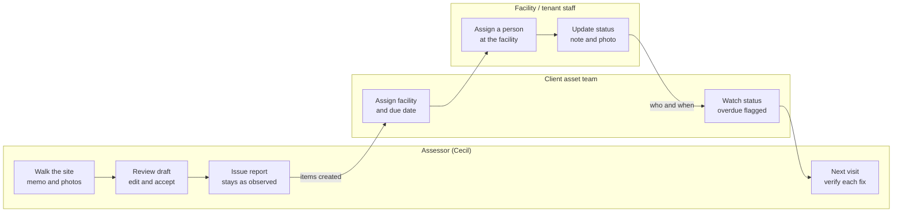

# v2 Spec — Assessments and Follow-up

Nov 25, 2026 · Michael. Exported from the "v2 Spec" tab of the Property Assessment Report App — Requirements doc. Update the doc and re-export, or edit here and tell Michael.

v2 rebuilds Cecil's Report Builder as one app for the whole assessment cycle: Cecil drafts the report from his walk-through, then the client and tenant close out its action items in the same app instead of by phone calls and spreadsheets.

## What changes from v1

v1 is a working one-person tool that ends at a PDF; v2 keeps everything Cecil approved in v1 and adds live follow-up after the report is issued. Follow-up needs accounts, roles, each client's data kept separate, and hosting that can run on a client's own server, so v2 starts fresh rather than adding onto v1. v1 (GitHub `main`, Nov 25) stays the working version and the reference.

| Area | Keep from v1 | Redesign in v2 |
| --- | --- | --- |
| Walk-through drafting | Reading the iPhone Voice Memos transcript from the .m4a; matching photos to remarks by time; drafted values Cecil accepts; re-draft keeps what he accepted; finalized reports as drafting examples | Runs on the server for every client copy |
| Report editing | Sections and subsections matching Cecil's reports; rating, then sentence, then notes; phrase library; merge findings; priority schemes; version history | Stored in a server database, not the browser |
| Photos | All Photos tray; one-tap Put in…; In report / Appendix only / Exclude; rotate; markup with text labels and numbered areas; one photo in two places | Files in server storage, kept forever |
| Output | Branded PDF in the approved order; Excel follow-up tracker; CSV | The tracker also becomes a live page |
| Issuing | Issued report locked as a revision | The assessment freezes at issue; its action items stay live |
| Users | Single sign-in for Cecil | Organizations, users and roles |

## Users and roles

The assessor identifies problems and never assigns them; the client decides who fixes what and by when. Cecil: "I can't tell anybody what to do."

| Role | Who | What they do |
| --- | --- | --- |
| Assessor | Cecil; later associates or other assessment firms | Upload walk-throughs, edit and issue assessments, see follow-up on their own assessments, verify fixes at the next visit |
| Client asset team | The owner's asset staff, e.g. MPT's analysts and directors | Receive reports, assign each action item to a facility, set or change due dates, watch status and overdue items, export to their work-order system |
| Facility / tenant | Operator staff at the property, e.g. a hospital's maintenance team | See only their facility's items, assign a person, update status with a note and photo; cannot change the assessment |
| Program coordinator | Someone who runs an owner's assessment program across several assessor firms | See every assessment and item across firms, keep templates consistent |
| Admin | Cecil for his own copy; the client's IT for theirs | Manage users, templates, branding and the phrase library |

## The cycle at a glance

Action items stay live after the report until the next visit verifies them.

v1 covers only the steps up to Issue report. Everything after it, and the check at the next visit, is new in v2.

## Data model

The property is the anchor across years; the action item is the one record that keeps changing after the assessment freezes.

| Record | Key fields | Notes |
| --- | --- | --- |
| Organization | Name, type (assessor firm, client, facility operator), branding | The boundary for keeping each client's data separate |
| User | Name, email, organization, role | Roles as in the table above |
| Property | Name, owner, use type, operator / tenant, address, latitude / longitude, tax parcel IDs, facility contact | Carried from one visit to the next |
| Template | Name, version, sections, subsections, standard sentences | Healthcare Master and Real Estate to start |
| Assessment | Property, template version, date and time, prepared by, personnel present, weather, general comments, priority scheme, action list order, status, revision | Frozen as observed once issued |
| Section and subsection | Rating (or worked out from subsections), standard sentence, notes or section summary | Subsections can be added, renamed, moved or deleted per report |
| Finding | Description, location, photos, observation-only flag, drafted marks, source remarks | One issue = one finding, many photos |
| Photo | File, time taken, GPS, rotation, markup (arrows, circles, numbered areas, text), state, one or more placements | Kept forever; deleting hides it but keeps the file for older versions |
| Action item | From the finding: title, recommendation, priority. Live: facility, assignee, due date, status | Outlives its assessment; checked at the next visit |
| Action update | Who, when, status change, note, photos | The audit trail behind "last updated" and overdue flags |
| Transcript | Timed remarks, remarks left out | Kept; the audio is deleted once used |
| Version | Snapshot of the assessment, note, time | Daily, on issue, or saved by hand |
| Phrase | Title, text | Per assessor; used by drafts |

## Assessor workflow

Everything here already works in v1 unless marked new; v2 carries it over on the new foundation. Cecil's rule for every screen: "anything you can do is one less click."

| ID | Requirement | Priority | Source |
| --- | --- | --- | --- |
| A-1 | Upload a walk-through (voice memo + photos) and get a drafted report: findings, ratings, notes, section summaries | Must | v1 |
| A-2 | Start from a property; details, personnel, parcels and Cecil's own subsections carry over from the last visit | Must | v1 |
| A-3 | Details page as approved: property name, owner, use type, operator / tenant, facility contact, address, latitude / longitude averaged from photo GPS, date and time, prepared by, template, personnel, tax parcel IDs, weather, general comments | Must | Nov 24 |
| A-4 | Good / Fair / Poor / N/A buttons, then the standard sentence, then a comment box, for subsections and sections; a section can work out its rating from its subsections | Must | Nov 24 |
| A-5 | Subsection row: Good, Fair, Poor, N/A, Delete, More (Rename, Move) | Must | Nov 24 |
| A-6 | One issue = one finding with all its photos; Merge findings; drafts follow the same rule | Must | Nov 23 |
| A-7 | All Photos tray on every editing screen; drag to place; photo viewer with one-tap Put in… | Must | Nov 24 |
| A-8 | In report / Appendix only / Exclude as one-click buttons; delete bad shots | Must | Nov 24 |
| A-9 | One photo in two places, with a warning in the app only | Must | Nov 23–24 |
| A-10 | Rotate photos; markup with arrows, circles, numbered areas linked to close-ups, and text labels; red, yellow, white | Must | Nov 23–24 |
| A-11 | Priority scheme per report: High / Medium / Low or Required / Recommended; switching converts | Must | Nov 24 |
| A-12 | Assignee and due date left blank by the assessor and printed as TBD | Must | Nov 24 |
| A-13 | Phrase library inserted in one tap and used by drafts | Must | Nov 23 |
| A-14 | Version history: saved daily, on issue and by hand; preview and restore | Must | Nov 23 |
| A-15 | Spelling check and pre-issue review | Must | v1 |
| A-16 | New: mark transcript remarks "Leave out" so things said aloud never reach drafts or the report | Should | Nov 23 |
| A-17 | New: the next visit pulls in last visit's open action items so Cecil can record fixed, not fixed or worse | Must | Nov 24 |

## Follow-up

Follow-up replaces Cecil's quarterly phone calls and hand-typed tracker: tenants update their own items and the client sees status as it changes.

| ID | Requirement | Priority |
| --- | --- | --- |
| F-1 | Issuing an assessment creates its action items in the tracker; the assessment itself stays as observed | Must |
| F-2 | The client assigns each item to a facility, and the facility to a person (e.g. MPT, then the hospital, then its maintenance tech); the client sets and changes due dates | Must |
| F-3 | Facility staff update an item's status with a note and photos from a phone, in a few taps | Must |
| F-4 | Every change records who and when; each item shows when it was last updated | Must |
| F-5 | Items past their due date are flagged on screen | Must |
| F-6 | Tracker views by property, facility and client portfolio, filtered by status, priority and overdue | Must |
| F-7 | Export items for the client's work-order system: the current Excel tracker columns plus CSV | Must |
| F-8 | "Done" is a claim: the next visit verifies it and records the result (A-17) | Must |
| F-9 | The client chooses per assessment: PDF only, or tenant access on the client's secured server | Must |
| F-10 | Program coordinator view across assessor firms | Could |

## Report and exports

The PDF stays the official record of the visit; the live tracker carries everything after it.

- **PDF order:** cover (property details and cover photo), executive summary, action items with Required / Recommended or High / Medium / Low counts, body of the report, photos.
- **Branding:** Cecil Ingram Properties (or the client's own in their copy); no vendor footer; US dates.
- **Action list order:** report order, priority or due date, chosen per report; the PDF and exports follow it.
- **Excel follow-up tracker:** Facility Name, Assessment Date, Action Item Description, Q1, Q2, Q3, Q4, Facility Contact. CSV as well.
- **Wording:** reports avoid alarming phrasing and carry the disclaimers on the cover, because Cecil is named in lawsuits over his findings.

## Hosting, security and quality

The working assumption is one copy of the app per client, on the client's own server and branded as theirs, because Cecil believes owners want that. Confirm with Cecil's IT contact before the architecture is fixed.

| Area | Requirement |
| --- | --- |
| Hosting | Packaged so one copy installs on a client's server; Cecil runs his own copy for his firm. The same package runs on a Mac, Cecil's computer, a managed host or a small cloud server |
| Data separation | Each organization sees only its own data; tenants see only their facility's items |
| Security | Encrypted in transit and at rest; no public links by default; the AI provider must not train on client data |
| Retention | Reports and photos kept forever; audio deleted once drafted; transcripts kept as drafting examples |
| Compatibility | Every older report opens and prints. There's no v1 import (Cecil has no real reports in v1); a plain JSON import loads test data |
| Devices | iPhone and iPad first; desktop for review and editing |
| Ease of use | Fewest possible clicks; Cecil and tenant staff need no training |
| Licensing | A yearly license key; reports stay readable after it lapses |

## Milestones

Each milestone ends with a test against real material before the next one starts. Cecil's February visits to four South Carolina hospitals are the target for field use.

1. **Plan.** Claude Code proposes the architecture, data model and milestone breakdown; nothing is coded until it's reviewed.
   - Test: the plan answers every open question below or names the decision it needs.
2. **Assessor workflow on the new foundation.** Everything in A-1 to A-16, plus F-1 (issuing creates the action items), with server storage and Cecil's account.
   - Test: rebuild the Midlands report from its photos, and draft a real walk-through from the local test building.
3. **Follow-up.** F-2 to F-9 and A-17: tracker, assignment, tenant updates, overdue flags, exports, and verification at the next visit.
   - Test: run one full cycle with three test users (client, facility, tech) on phones.
4. **Second client.** Install a separate copy with its own branding, users and templates.
   - Test: nothing is shared between the two copies.
5. **Field use.** Cecil uses v2 for real visits.
   - Test: the February hospital reports go out from v2.

## Decisions log

Add a row after every meeting with Cecil; this table is the source of truth for the build.

| Date | Decision |
| --- | --- |
| Nov 25, 2026 | Plan approved (`docs/plan.md`); details and reasons in `docs/decisions.md` |
| Nov 25, 2026 | Hosting: build once, install anywhere. One package keeps each organization's data separate; a client gets its own organization in Cecil's copy or the same package on its own server. Hosting details to confirm with Cecil's IT contact before Milestone 4 |
| Nov 25, 2026 | No staging server for now; the package runs on Michael's Mac with one command and fixture data. Hosting for Cecil's real copy is chosen before he uses v2 for real |
| Nov 25, 2026 | Provisional: in a client's own copy, Cecil works inside that copy as an assessor user. Confirm with Cecil's IT contact before Milestone 4 |
| Nov 25, 2026 | Tenants sign in with personal secure links (one per named person, no password, their facility's items only); no shared links. Cecil and client staff sign in with an email link, then Face ID |
| Nov 25, 2026 | Provisional: action item statuses are Open, Assigned, In progress, Done, Deferred. Facility or client marks Done; only the client marks Deferred or changes due dates; only the assessor records Fixed, Not fixed or Worse at the next visit. Confirm with Cecil |
| Nov 25, 2026 | Issued means the report is frozen (stored with its PDF) and its action items stay live; a revision is a new frozen copy and its items carry over by finding |
| Nov 25, 2026 | Drafting examples come only from the same client's reports |
| Nov 25, 2026 | Provisional: a section's rating stays the average of its subsections, overridable. Confirm with Cecil |
| Nov 25, 2026 | No third priority scheme for now |
| Nov 25, 2026 | Overdue items flagged on screen only; an opt-in weekly email digest comes later |
| Nov 25, 2026 | Provisional: Cecil's questionnaires, templates and phrases belong to his firm, installed into client copies as a licensed pack. Terms go to a lawyer |
| Nov 25, 2026 | No v1 import: Cecil has no real reports in v1. A plain JSON import is kept for test data |
| Nov 25, 2026 | Milestones: F-1 moves into Milestone 2 and A-17 into Milestone 3 |
| Nov 25, 2026 | Original photos always kept; offline next-visit checklist on the iPad; program coordinator view deferred until after Milestone 3; site videos out of scope for the first release |
| Nov 25, 2026 | Build v2 fresh with v1's best parts plus live follow-up; v1 stays the working version |
| Nov 24, 2026 | The assessor identifies; the client or tenant assigns and dates. Assignee and due date print as TBD |
| Nov 24, 2026 | Tenants update action items through a link on the client's secured server; the assessment stays frozen and a separate tracker carries follow-up |
| Nov 24, 2026 | Ratings layout: buttons, then sentence, then comment box, for sections and subsections |
| Nov 24, 2026 | Subsection row is Good, Fair, Poor, N/A, Delete, More; "Hide from this report" removed |
| Nov 24, 2026 | All Photos tray on every page, one-tap assign from the viewer, photo states as buttons |
| Nov 24, 2026 | Details page approved as built |
| Nov 24, 2026 | Priority scheme chosen per report; switching converts High to Required, Medium and Low to Recommended |
| Nov 24, 2026 | PDF order: cover, executive summary, action items, body; action list order chosen per report |
| Nov 23, 2026 | Follow-up tracker uses quarterly columns (Q1 to Q4) |
| Nov 23, 2026 | One issue is one action item with all its photos |
| Nov 23, 2026 | Cecil's view: owners want the app on their own servers, branded as theirs, with a yearly license and paid customizations |
| Nov 21, 2026 | PDF only, no Word; reports and photos kept forever |

## Open questions

- [x] One copy per client on their own server, or one shared site? Decided Nov 25: build once, install anywhere. Confirm hosting details with Cecil's IT contact before Milestone 4.
- [ ] In a client's own copy, does Cecil work inside it as an assessor user? Provisional yes; confirm with Cecil's IT contact before Milestone 4.
- [ ] Where does Cecil's real copy run (Cecil's computer, a managed host or a small cloud server)? Choose before he uses v2 for real.
- [x] How do tenants get in: their own logins, or secure links with no password? Decided Nov 25: personal secure links, no password.
- [ ] What are the action item statuses, and who can mark an item done? Provisional: Open, Assigned, In progress, Done, Deferred (see Decisions log). Confirm with Cecil.
- [x] What does "issued" mean now: a locked report with live items (proposed), or something else? Decided Nov 25: as proposed.
- [x] Email reminders for overdue items, or on-screen flags only? Decided Nov 25: on-screen flags; an opt-in weekly digest later.
- [ ] Whose Claude account does drafting use in each client's copy? Recommended: Cecil's own account for his copy; the client's own account (Anthropic, or their Bedrock, Vertex or Foundry) for theirs (plan 12.20). Needed before step 2.8.
- [ ] Should a section's rating stay the average of its subsections, or take the worst one? Provisional: the average. Confirm with Cecil.
- [x] Add Immediate / Short-term / Long-term as a third priority scheme? Decided Nov 25: not for now.
- [ ] Who owns Cecil's questionnaires and phrases if the app is sold to others, and on what terms? Provisional: they belong to Cecil's firm, as a licensed pack. Terms go to a lawyer.
- [ ] What does the program coordinator need? Ask at the meeting next week. Deferred until after Milestone 3.
